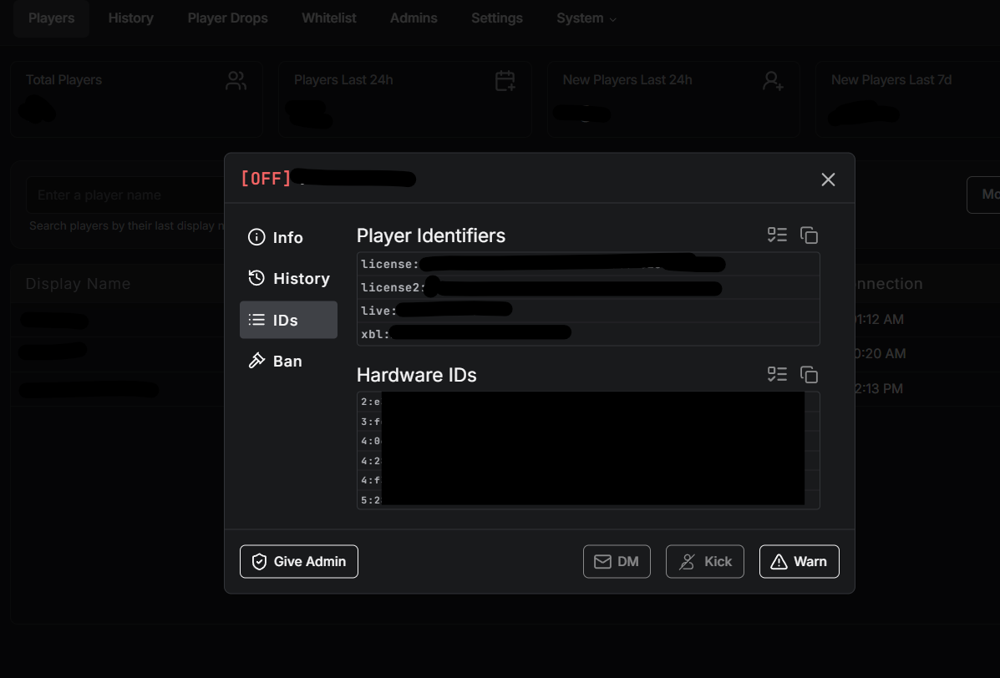

# How to Add Admins

You add the owner once in `permissions.cfg`. Everyone else can be added in game from the admin menu, with roles and permissions you pick yourself. No restart needed.

***

## Permission Levels

| Level | Where it comes from | Who it's for |
| ----- | ------------------- | ------------ |
| **God** | `group.admin` in `permissions.cfg` | Owners - full access to everything. Cannot be changed in game |
| **Admin** | `group.mod` in `permissions.cfg`, or given in game | The built-in role for everyday staff |
| **Your own roles** | Given in game | Any role you make, like Helper or Builder, with exactly the permissions you pick |

***

## Step 1 - Add the Owner

The owner (god) is the only one you have to add in `permissions.cfg`. You can use a Discord ID or a license identifier.


Our txAdmin recipe adds your txAdmin master account as owner, but this only works if your CFX account is linked to FiveM. Most people still need to do this step. If you used the manual download, put your license in the `YOUR_LICENSE_HERE` line that is already in `permissions.cfg`.




**Get your identifier**

* **Discord ID** - right click yourself in Discord and pick **Copy User ID** (Developer Mode must be on in Discord settings)
* **License** - open **txAdmin**, go to **Players**, select the player, scroll to **Player Identifiers** and copy the `license:` value

<figure><figcaption></figcaption></figure>



**Add it to permissions.cfg**

```
add_principal identifier.discord:YOUR_DISCORD_ID group.admin
```

or

```
add_principal identifier.license:YOUR_LICENSE_HERE group.admin
```



**Restart the server**

Changes in `permissions.cfg` only apply after a restart.



***

## Step 2 - Add Staff In Game

As the owner, you add the rest of your staff from the admin menu. It is saved in the database and stays after a restart.



**Open the Staff page**

Press **F9** or type `/admin` and go to **Staff**



**Add staff**

Click **Add staff**, enter the player's State ID and pick a role. They get access right away



**Make your own roles**

Open **Roles** to create roles like Helper or Builder. Tick exactly which permissions each role has. Every meteo script adds its own permissions here, so you can give a role access to one script without giving it the rest



**Give extra permissions**

Edit a staff member and use **Add permissions** to give that one person more on top of their role




Script settings and creators are god only out of the box. If you want, give the **Change script settings** or **Build and change creator records** permission to a role. See [In-Game Creators and Settings](../in-game-creators.md).


***

## Using permissions.cfg for Staff

You can still add staff in `permissions.cfg` with `group.mod`. They get the built-in **Admin** role and show in the Staff page as "Given in permissions.cfg". To remove them, take them out of the file.

```
# Owner
add_principal identifier.license:xxxxxxxxxxxxxxxxxxxxxxxxxxxxxxxxxxxxxxxx group.admin

# Staff
add_principal identifier.discord:000000000000000000 group.mod
```


[Meteo Manage](../scripts/meteo-manage/)


***


**Need help?** Open a ticket on our official Discord at <a href="https://discord.meteofivem.net" target="_blank">discord.meteofivem.net</a>. Our team is there to help every customer.

