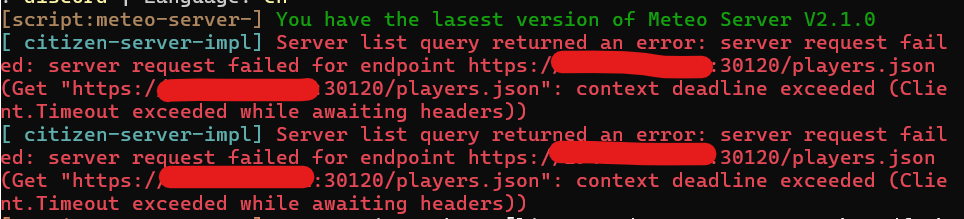

# How to Fix Server List Query Error

If you see `[citizen-server-impl] Server list query returned an error` in your console, your server cannot be reached by the FiveM master server and will not show up in the public server list.

<figure><figcaption></figcaption></figure>

<figure><figcaption></figcaption></figure>

***

### Step 1: Set sv\_listingIpOverride

1. Open your `server.cfg` file.
2. Set `sv_listingIpOverride` to your server's IP address only. Do not add a port.

```
set sv_listingIpOverride "your_ip"
```

3. Save the changes and restart the server.

This resolves the error in most cases. It is mainly needed when your server has more than one IP, or the server list cannot work out which IP to reach.


For more info about these settings, see the official FiveM <a href="https://docs.fivem.net/docs/server-manual/proxy-setup/" target="_blank">proxy setup guide</a>.


***

### Step 2: Open Required Ports

If the error persists after Step 1, the most common cause is misconfigured firewall or router. You need to open the following ports:

* **30120 TCP/UDP** - FiveM server
* **40120 TCP** - txAdmin

How you open ports depends on your setup (Home Host, Windows VPS, Linux VPS, or Game Server Provider). Check your host's documentation or firewall settings.

***

### Step 3: Update FiveM Artifacts

Outdated server artifacts can also cause this issue. Make sure you are running the latest recommended FiveM artifacts:

* Windows: <a href="https://runtime.fivem.net/artifacts/fivem/build_server_windows/master/" target="_blank">FiveM Windows Artifacts</a>
* Linux: <a href="https://runtime.fivem.net/artifacts/fivem/build_proot_linux/master/" target="_blank">FiveM Linux Artifacts</a>

***

### Step 4: Remove sv\_master1

Make sure you do **not** have `sv_master1` set in your `server.cfg`. This setting is deprecated and can cause issues.

***

### Step 5: Check Your Hosting

If you have done all of the above and the issue is still not fixed, this is most likely a hosting provider issue. Some cheap or unknown hosts have networking restrictions that block the FiveM master server from reaching your server.


Always use well known hosting providers. Cheap or unknown hosts often have networking issues that cause this error and other connectivity problems.


***


**Still stuck?** Open a ticket on our official Discord at <a href="https://discord.meteofivem.net" target="_blank">discord.meteofivem.net</a> and our team will help you out.

