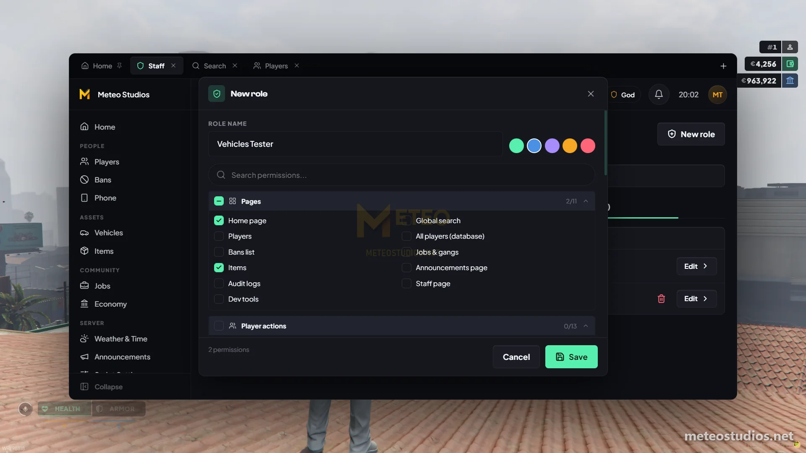

# How to Change Script Permissions

<figure><figcaption>
Creating a role and picking its permissions in the admin menu
</figcaption></figure>

Every meteo script with admin features adds its own permissions to the admin menu. You decide in game which roles get them. No files to edit and no restart.

***

## How it works

* Each script shows up in **Staff > Roles** with its own permissions, for example "Bennys admin" or "Properties admin"
* Out of the box, most script permissions are given to the built-in **Admin** role. Sensitive ones are god only
* God always has every permission

***

## Give a Script to a Role



**Open Roles**

Press **F9** or type `/admin`, go to **Staff** and open **Roles**



**Pick or create a role**

Edit an existing role or create a new one, for example "Vehicle Team"



**Tick the permissions**

Find the script in the list and tick the permissions you want this role to have. Untick them to take them away



**Save**

It applies right away for everyone with that role




Want to give one person access without changing their whole role? Edit them on the Staff page and use **Add permissions**.


***

## Examples

* **Vehicle team** - make a role, tick only the Dealerships and Bennys permissions, and add your vehicle staff to it
* **Owner only script** - untick the script's permissions on every role, so only god can use it
* **Builders** - give a role **Build and change creator records** so they can place locations with the [in-game creators](../in-game-creators.md), without access to anything else

***

## Without the Admin Menu

The `server/sv_permissions.lua` file in each script is only used when the admin menu is not running. Then the ace permissions listed there decide who is an admin, by default `admin` (owners) and `mod` (staff). You don't need to touch it when you use the admin menu.


[How to Add Admins](how-to-add-admins.md)


***


**Need help?** Open a ticket on our official Discord at <a href="https://discord.meteofivem.net" target="_blank">discord.meteofivem.net</a>. Our team is there to help every customer.

