# Installation Guide

Meteo package installation is the easiest installation you can find. We have optimized this as best as we can. If you have any questions, open a ticket on our <a href="https://discord.meteofivem.net" target="_blank">Discord</a>.

***

## Setting Up



**VS Code and WinRAR**

First set up <a href="https://code.visualstudio.com/" target="_blank">VS Code</a>. Also <a href="https://www.rarlab.com/download.htm" target="_blank">WinRAR</a> if you need it



**HeidiSQL with MariaDB**

Set up <a href="https://mariadb.org/download" target="_blank">MariaDB</a> and <a href="https://www.heidisql.com/download.php" target="_blank">HeidiSQL</a>. Make sure to set no password



**FiveM artifacts**

Download the FiveM artifacts from <a href="https://docs.fivem.net/docs/server-download/" target="_blank">here</a>



***

## Install the Package

There are 2 ways to install. Pick one of the tabs below.




txAdmin downloads everything and sets up the database for you. If the recipe fails, use the manual download




**Create your server folder**

Create a new folder with the name you want. This is where your files will be. Inside it create a folder called `fivem-data` and put the artifacts there. This keeps the artifacts organized and easy to update when there is a FiveM artifact update



**Open FXServer**

Now find `FXServer.exe` inside `fivem-data` and open it. Run the txAdmin setup process as usual



**Deployment type**

On the deployment type select **Remote URL Template**

<figure>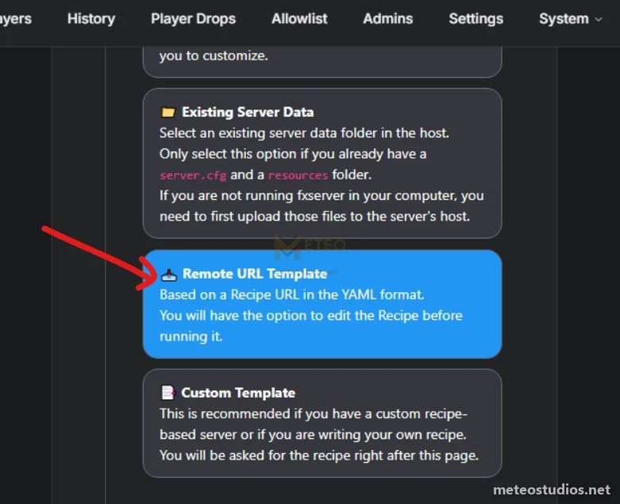<figcaption></figcaption></figure>



**Paste our recipe**

Paste this and click **Next**

```
https://raw.githubusercontent.com/MeteoStudios/meteo-v2-recipe/main/recipe.yaml
```

<figure>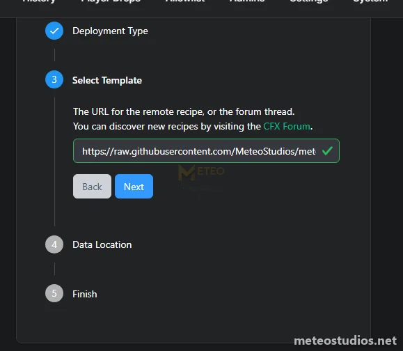<figcaption></figcaption></figure>



**Data location**

Keep the suggested path and click **Save**

<figure>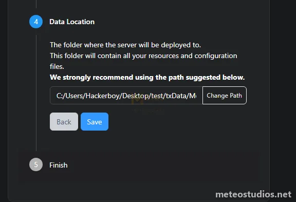<figcaption></figcaption></figure>



**Recipe deployer**

Click **Go to Recipe Deployer**

<figure>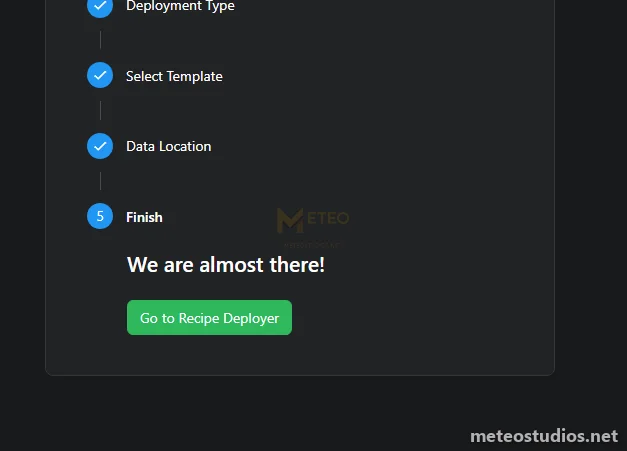<figcaption></figcaption></figure>



**Review recipe**

Click **Next**

<figure>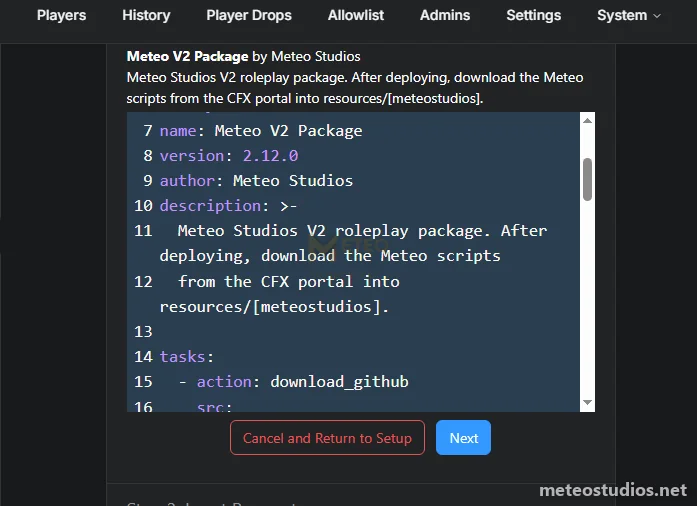<figcaption></figcaption></figure>



**License key**

Get the license key from <a href="https://portal.cfx.re/servers/registration-keys" target="_blank">here</a>, paste it and click **Run Recipe**


Make sure this is the CFX account you used when you made the purchase. Otherwise it will not work


<figure>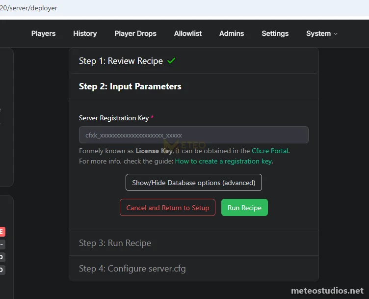<figcaption></figcaption></figure>



**Wait**

Wait for it to download the recipe

<figure>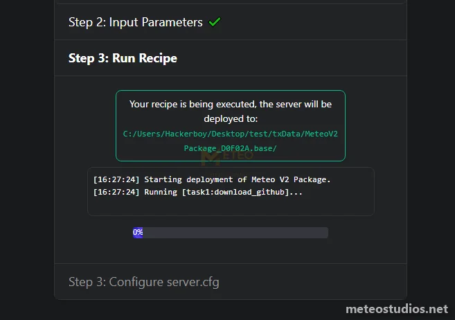<figcaption></figcaption></figure>



**Done**

Once it says done click **Next**

<figure>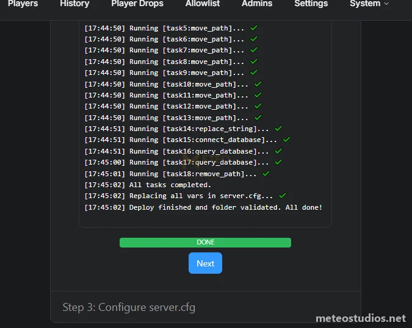<figcaption></figcaption></figure>



**Do not start the server yet**

Don't click **Save & Run Server** yet. Keep this page open

<figure>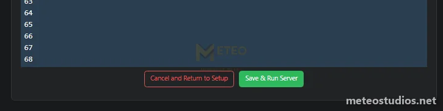<figcaption></figcaption></figure>



First part is successfully done now :) Lets go to the [Meteo Scripts](#meteo-scripts) part.




Same package as the recipe, you just download it and run the SQL files yourself




**Create your server folder**

Create a new folder with your brand name or anything you want. This is where your files will be



**Download the package**

Download `meteo-v2-package-recipe.zip` from <a href="https://github.com/MeteoStudios/meteo-v2-recipe/releases/latest/download/meteo-v2-package-recipe.zip" target="_blank">here</a> and unzip it into your folder. You will get the `server-data` and `database` folders



**License key**

Get the license key from <a href="https://portal.cfx.re/servers/registration-keys" target="_blank">here</a>. Open `server-data\server.cfg` and put it in place of `ENTER_YOUR_LICENSE_KEY`

```
sv_licenseKey "your_license_key"
```


Make sure this is the CFX account you used when you made the purchase. Otherwise it will not work




**Run the SQL files**

Open the `database` folder. Click on the SQL file, open it using HeidiSQL and run it. Do it in this order

1. `meteov2.sql`
2. `meteov2data.sql`


You must run `meteov2.sql` first. It creates the `meteov2` database and the tables. Don't run `meteov2data.sql` first or it will fail




**FiveM Data**

Download the FiveM artifacts from <a href="https://docs.fivem.net/docs/server-download/" target="_blank">here</a> if you haven't already. Inside your folder create a folder called `fivem-data` and put the artifacts there. This keeps the artifacts organized and easy to update when there is a FiveM artifact update



**Open FXServer**

Now find `FXServer.exe` inside `fivem-data` and open it. Run the txAdmin setup process as usual



**Deployment type**

On the deployment type select **Existing Server Data**

<figure>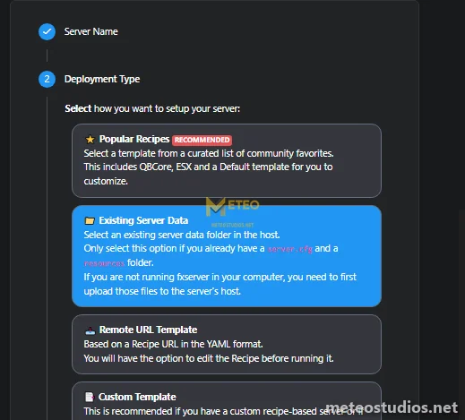<figcaption></figcaption></figure>



**Server data folder**

Copy the path to your `server-data` folder, paste it and click **Next**. It will find the `server.cfg`, click **Save**

<figure>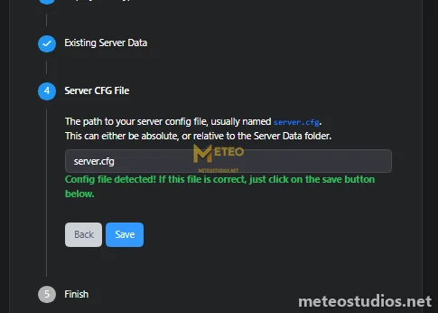<figcaption></figcaption></figure>



**Do not start the server yet**

Don't start the server yet. Lets add the scripts first



First part is successfully done now :) Lets go to the [Meteo Scripts](#meteo-scripts) part.



***

## Meteo Scripts



**Download the scripts**

Go to the CFX portal and download **Meteo Studios Scripts Bundle** from <a href="https://portal.cfx.re/assets/granted-assets?page=1&sort=asset.updated_at&direction=asc&search=Meteo+Studios+Scripts+Bundle" target="_blank">here</a>



**Unzip to resources**

Open your `resources` folder, open the downloaded zip and unzip it there


Make sure you end up with `resources\[meteostudios]` and not a folder inside another folder


<figure>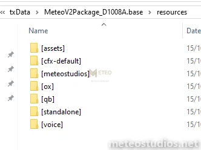<figcaption></figcaption></figure>



**Start the server**

Now go back to txAdmin and start the server. If you used the recipe click **Save & Run Server**



That part is done.

***

## Prompt Studio Maps


This part is optional. Skip it if you are not using Prompt Studio maps


If you would like to use Prompt Studio maps, follow the guide below. Default locations are configured for these maps. Thanks to Prompt Studio for supporting us and collaborating with us. You can get the Prompt Studio maps for our package from <a href="https://store.prompt-mods.com/store/package/7718215" target="_blank">here</a>.


You can set up the package for any maps you want using our <a href="https://docs.meteostudios.net/packages/meteo-v2-package/in-game-creators" target="_blank">in-game creators</a>, without having to change any code.




**Download all maps**

Download all of these from the CFX portal carefully

<details>

<summary>Maps list</summary>

* Prompt's - MRPD \[Mission Row Police Department]
* Prompt's - Sandy Shared Files
* Prompt's - Pillbox Hospital
* Prompt's - Complete Bolingbroke Prison
* Prompt's - Burgershot (FastFood Chain)
* Prompt's - Chinese Casino | Secret Triad HQ
* Prompt's - Barber Shop
* Prompt's - Tattoo
* Prompt's - Ammunation Small (Rework)
* Prompt's - Sandy Corner \[Bowling, Diner, SteakHouse]
* Prompt's - Sandy Corner \[Arcade Script]
* Prompt's - Sandy City Hall
* Prompt's - Sandy Sheriff Station
* Prompt's - Sandy Shores Hospital V2
* Prompt's - Sandy Marina | Beaches
* Prompt's - Sandy Shores Houses | part 1
* Prompt's - Sandy Car Dealership
* Prompt's - Sandy Shores Mechanic
* Prompt's - Sandy Motel
* Prompt's - Sandy Market
* Prompt's - Sandy Apartments
* Prompt's - Sandy Roads Rework + Traffic
* Prompt's - Sandy Downtown
* Prompt's - Horny's | Sandy Only (FastFood Chain)
* cfx\_prompt\_paleto\_cityhall

</details>



**Unzip to prompt-maps**

Unzip everything and put it in the `resources\[assets]\[prompt-maps]` folder. Make sure to put them in the right folder



**Run meteo-promptmaps.bat**

Stop the server and run `tools\meteo-promptmaps.bat`


You must run this. Otherwise some of the default Prompt maps are not aligned. Run it again after every map update




**Sandy map data**

Start the server once. If there is no map data, the console shows **Mapdata does not exist** with a download link to Prompt's map data tool

<figure>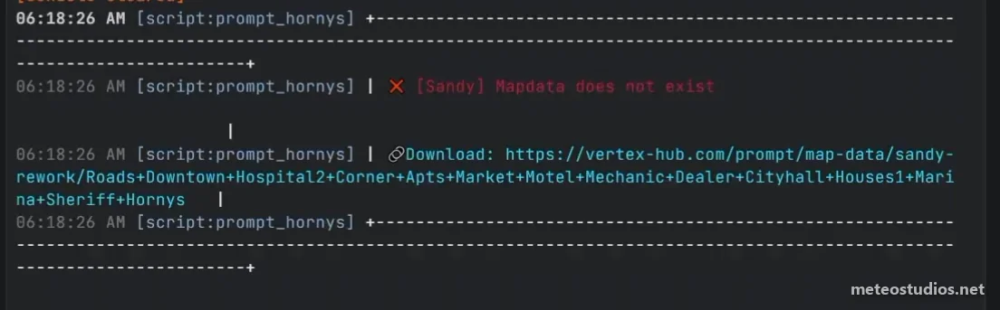<figcaption></figcaption></figure>

Open the link, make your map data there and put the `cfx_prompt_sandy_mapdata` folder in `resources\[assets]\[prompt-maps]`



**Check the map data**

Restart the server and check the console. Make sure it shows **Mapdata is the same as maps installed** like this

<figure>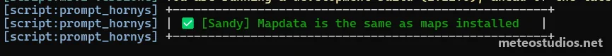<figcaption></figcaption></figure>



**Join**

That's it, now you can join :)



***

For more configurations please refer to the configuration guide.


[Configuration Guide](configuration-guide.md)



**Need help?** Open a ticket on our official Discord at <a href="https://discord.meteofivem.net" target="_blank">discord.meteofivem.net</a>. Our team is there to help every customer.

