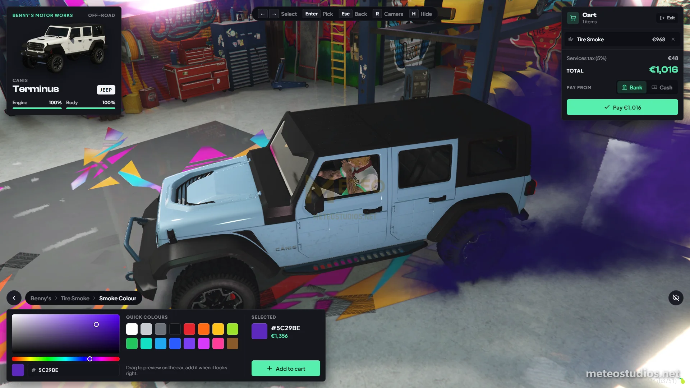

# Meteo Bennys

<figure><figcaption>
Meteo Bennys customization menu
</figcaption></figure>

This is a guide about testing the Meteo V2 vehicle customization (bennys) script designed exclusively for the Meteo V2 package.


Get access to our exclusive video testing guide on Discord to see all of this in action.



Try it yourself for free on our showcase server. [See here to get access](../../how-to/how-to-access-showcase-server.md).


***

## Before You Start

* Access to the meteo showcase server
* Familiar with [getting started](../../getting-started.md) basics

***

## Testing Bennys

### Basic Customization



#### Go to a bennys location



This is made for helicopters, boats and also vehicles. Lets go check Sandy Bennys for cars `/tp 1697.90, 3706.93, 33.52`. Helicopters and boats go to Higgins Bennys.



#### Spawn a vehicle



`/car adder` or spawn any vehicle.



#### Open customization menu



Drive into the bennys area, stay in the driver seat and press `E`. This is public and anyone can get customizations but if a mechanic is online then you must place an order instead.



#### Preview and buy



Pick parts and colors, they preview live on your vehicle. Drag to orbit the camera and scroll to zoom. Add what you like to the cart and pay from bank or cash. If you leave without paying your vehicle goes back to how it was.



> If you don't want the mechanic requirement, it can be turned off in the config once you get the package. We will guide you.

### Bennys Locations

* **Sandy Bennys** - `/tp 1697.90, 3706.93, 33.52` (at Sandy Customs)
* **Higgins Bennys** - `/tp -744.41, -1467.88, 5.39` (helicopters and boats)

### Customization Options

* Performance mods (engine, brakes, transmission, suspension, armor, turbo)
* Cosmetic mods (spoiler, bumpers, skirts, exhaust, hood, fender, roof and more)
* Liveries, including addon vehicle liveries
* Interior parts and interior color
* Respray (primary, secondary, pearlescent and more, with a palette, custom colors and hex input)
* Wheels and tires
* Xenon lights, neon and tire smoke colors
* Window tint and horns (you can play a horn before buying)
* Extras and repair

### Repair



Damage your vehicle a bit and drive into a bennys location



Open the menu and pick repair. Empty your cart first if you have anything in it



Confirm and your engine and body gets fixed. The menu closes when it is done



### Mechanic Orders


Make sure to use `/setjob yourid mechanic 4` to test mechanic orders - note this command is only available on our showcase server.


* Try placing order and see its giving the `meteo_mechreceipt` item to you
* After that for more info check out the mechanic job testing guide


[meteo-mechanicjob](../meteo-mechanicjob/)


### Building Bennys Locations (Admins)



Open the admin menu and go to Script Settings > Creator > Benny's



Add a new location, give it a name, pick the mechanic job that gets orders placed there and choose if it shows on the map



Aim at the middle of the garage floor to place the drive-in area and scroll to size the circle



Save it and it is live for everyone right away, no restart needed



* Perk XP for purchases and repairs can also be changed in game from Script Settings > Benny's

***

## Good to Know


Perk XP rewards are editable in-game from **Script Settings** in the admin menu ([meteo-manage](../meteo-manage/)), and you can add or edit Bennys locations (name, area, blip and the mechanic shop that gets the orders) in-game with the Benny's creator - no code editing needed, and your changes survive script updates. Script Settings is god tier only. Mod prices, order fees, tax and the mechanic requirement still live in the config. We will guide you :)

