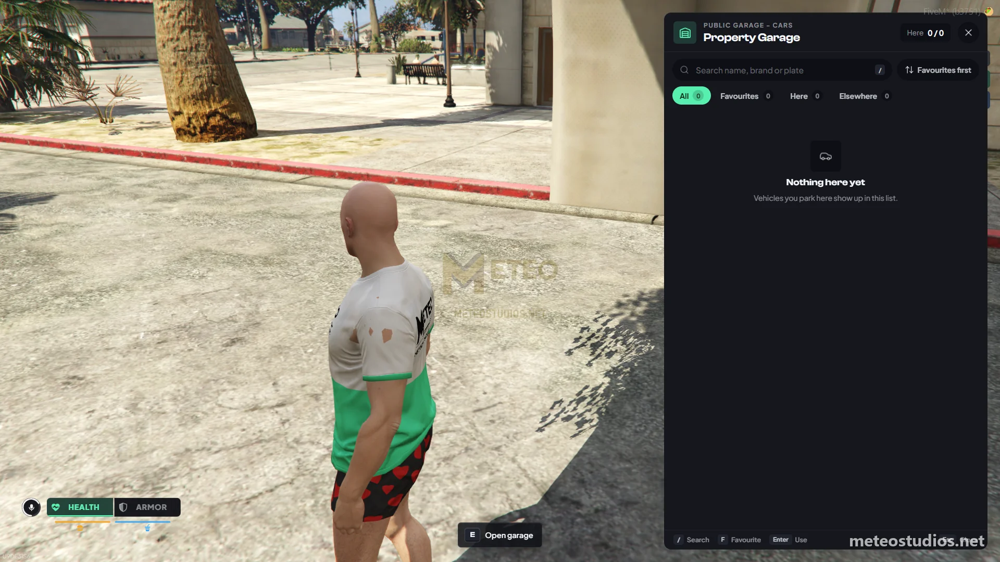
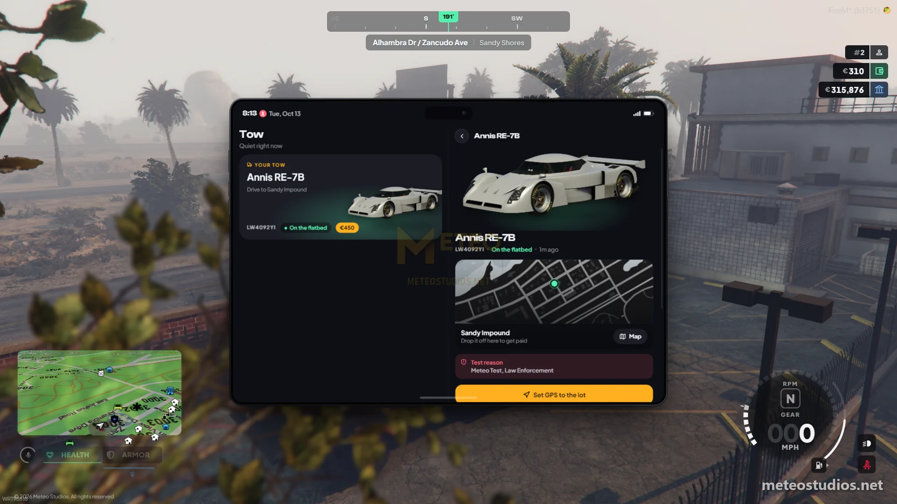
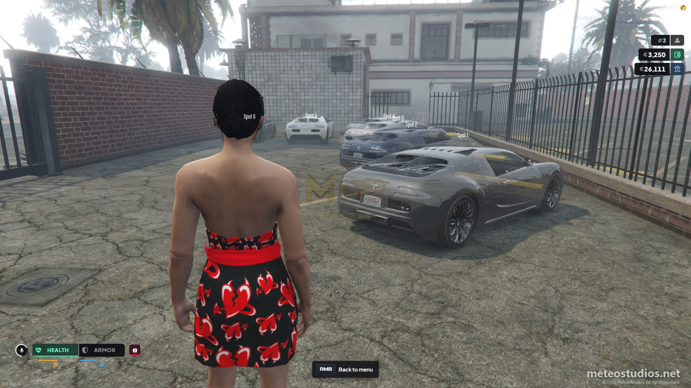

# Meteo Garages

<figure><figcaption>
Meteo Garages
</figcaption></figure>

<figure><figcaption>
Towing seized vehicles
</figcaption></figure>

<figure><figcaption>
Garages in-game creator
</figcaption></figure>

This is a guide about testing the Meteo V2 advanced garages script designed exclusively for the Meteo V2 package. Garages, impound lots and depots are all built in game now, and police seizures can be sent to a tow job instead of the car just vanishing.


Get access to our exclusive video testing guide on Discord to see all of this in action.



Try it yourself for free on our showcase server. [See here to get access](../../how-to/how-to-access-showcase-server.md).


***

## Before You Start

* Access to the meteo showcase server
* Familiar with [getting started](../../getting-started.md) basics

***

## Testing Garages



**Storing and Retrieving Vehicles**

Use `/tp 1643.84, 3801.33, 33.80` on chat and teleport to Sandy Parking, the public garage. Spawn a vehicle with `/car adder`. Then press E and try to store it. You will get a notify that you don't own this vehicle. Use `/admincar` and try again, now it must store the vehicle. Press E again to open the garage menu. On the menu you can take out the vehicle. Click take out and see it come out on a free parking spot.


`/admincar` is only for admins. This is a testing command.




**Garage Menu**

On the garage menu you can search by name, brand or plate, filter by favourites, here or elsewhere, and favourite a vehicle. Each vehicle shows its mileage, fuel, engine and body. If a vehicle is parked at another garage you can transfer it to this one for a fee.



**Depot (Vehicle Recovery)**

Now drive off and use `/dv` to delete the vehicle. Now go to `/tp 1285.66, 3626.60, 33.04`. This is the Sandy Depot. Talk to the depot attendant and you can get the vehicle back by paying a fee. These fees are configurable.


`/dv` is for just testing purposes.




**Police Impound**

Now set your job to police `/setjob yourid police 4` and go on duty. Look at the vehicle and use the **Impound vehicle** target, or use `/impound` on chat. You can also use the **Send to depot** target or `/depot` to send it to the depot.

For an owned vehicle the MDT opens on that vehicle's profile with the impound form. Pick the impound type and the level, add a reason and impound it. Each level has its own fee and hold time, like Reckless Driving for 1 hour or Used in a Crime for 24 hours.

Now go to `/tp 1860.43, 3695.34, 33.77` (this is the Sandy Impound) and talk to the impound clerk. If the vehicle is still held, the clerk shows how long is left. Once the hold is over, pay the fee and take out the vehicle.

`/impound` and `/depot` only work for on duty police. You can't impound a vehicle with someone inside. If the tow job is enabled (it is by default), an owned vehicle is not removed right away. It waits for a tow truck instead, see the next section.


Officers with the right MDT permission can release a hold early from the vehicle profile in the MDT.



`/setjob` is a testing command and only works on our showcase server.




### Other Sandy Garages

* **Sandy Air Hanger** - `/tp 1427.66, 3729.75, 32.21` (aircraft)
* **Sandy Boathouse** - `/tp 1503.99, 3818.00, 27.89` (boats)
* **Sandy Boat Impound** - `/tp 1504.84, 3829.86, 31.18`
* **Sandy Boat Depot** - `/tp 1499.80, 3837.16, 31.18`

***

## Testing the Tow Job

When police use `/impound` or `/depot` on an owned vehicle, it stays where it is, locked, and a tow request goes out to the mechanic job. The tow driver loads it on a flatbed and drops it off at the impound lot or depot. Unowned cars, boats, aircraft and cars with someone inside are still removed instantly.



**Request a Tow**

Spawn a vehicle with `/car adder` and use `/admincar` so it is owned. Get out of it, set your job to police `/setjob yourid police 4` and use the **Impound vehicle** or **Send to depot** target on it. You will get a notify that the tow is requested and the car stays there until a tower picks it up.



**Accept the Request**

Set your job to mechanic `/setjob yourid mechanic 4`. Open your phone and go to the **Tow** app. You will see the request on the board with the car and where it needs to go. Accept it and the route is set to the car.



**Load the Car**

Spawn a flatbed with `/car flatbed` and back it up close to the car. Get out, look at the car and use **Load onto flatbed**. The car is loaded and a route is set to the right lot.



**Drop It Off**

Drive to the impound lot or depot and park near the clerk. Get out, look at the flatbed and use **Drop off car**. You get paid to your bank and the car is now in the impound or depot for the owner to pay and collect. Tows only go to lots that take that vehicle type.




If nobody takes the request in time, or the tower leaves, goes off duty or takes too long, the car is sent to the lot automatically so nothing gets stuck. The tower can also report the car missing from the Tow app if it is not at the spot.


***

## Testing the Garage Creator

Garages, impound lots and depots are no longer in the config. Admins build them in game and the change applies live with no restart.



**Open the Creator**

Open the admin menu with `/admin` and go to script settings, then the creator, then **Garages**.



**Add a Garage**

Add a new one and pick the type - garage, impound or depot - and the vehicle type it takes (cars, aircraft, boats or all). Give it a name.



**Place It**

For a garage, place the point where players press E and set how close they need to be. For an impound or depot, pick the clerk ped and place it. Then add the parking spots by sitting in a car on each spot and saving it.



**Save**

Choose if it shows on the map and save. It is live straight away. If you delete a garage, any cars parked there are moved to the depot for free so nobody loses a vehicle.




The creator is part of the admin menu script settings, which is god tier only. You can also export, import and save your garages as presets to share them.


***

## Good to Know


Add or edit garages, impound lots and depots (type, vehicle class, clerk ped, spawn points and blip) in-game with the Garages creator in the admin menu ([meteo-manage](../meteo-manage/)) - no code editing needed, and your changes survive script updates. There are multiple garage, impound and depot locations around the map already set up, including car, air and sea garages. The impound levels (category, level, fee and hold hours) are changed in **Script Settings** > **Garages**. Depot fees, transfer fees, tow pay, tow jobs and which jobs can impound still live in the config. We will guide you :)

