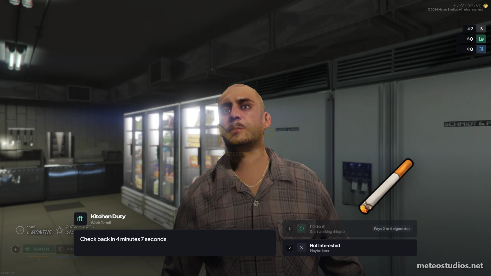
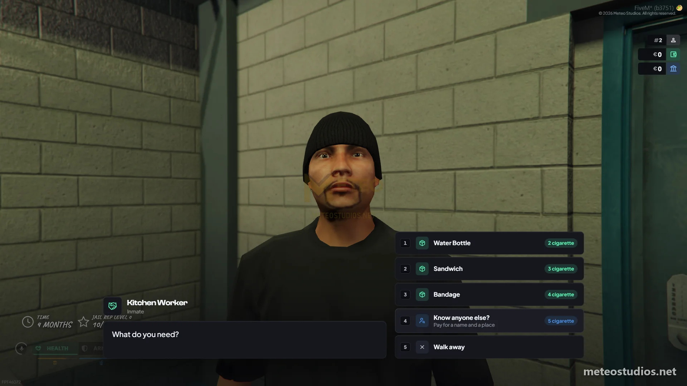

# Meteo Jail

<figure><figcaption>
Meteo Jail
</figcaption></figure>

<figure><figcaption>
Meteo Jail
</figcaption></figure>

<figure><figcaption>
Meteo Jail
</figcaption></figure>

This is a guide about testing the Meteo V2 jail and prison script designed exclusively for the Meteo V2 package.


Get access to our exclusive video testing guide on Discord to see all of this in action.



Try it yourself for free on our showcase server. [See here to get access](../../how-to/how-to-access-showcase-server.md).


***

## Before You Start

* Access to the meteo showcase server
* Know how to [spawn items](../../how-to/how-to-spawn-items.md)
* Familiar with [getting started](../../getting-started.md) basics


The prison is no longer set up in the config file. Every place is built in game from the admin menu (Script Settings > Jail > Creator) - the prison zone, cell and solitary spawns, release point, belongings, release and visitation peds, canteen, traders, work details, map blips and the escape route. A fresh server ships with all of them already placed, so the `/tp` coordinates below are correct until someone moves a place.


***

## Jail Creator and Settings



Open the admin menu with `/admin` and go to Script Settings > Jail



Open the Creator and you will see every jail place as a record. Pick a kind (Prison zone, Cell spawns, Solitary spawns, Release point, Belongings ped, Freedom ped, Visitation ped, Canteen, Trader, Work detail, Map blip or Escape route) and place it where you are standing



Back in Script Settings > Jail you can tune the sentence (how long a month lasts and which jobs can jail), meals, belongings stash size, rewards, the escape and the male and female prison uniform. Saving applies straight away, no restart needed




If there is no Freedom ped record, a prisoner whose time is up cannot get out. The server console tells you on startup.


***

## Testing Jail

### Getting Jailed



Make sure you have the policejob to do this



Use command `/jail` and it will open a menu and enter your id and add like 10 months since we are just going to test



Police can also sentence someone straight from a charge sheet in the [MDT](../meteo-mdt/). The suspect has to be online so the prison can move them




Jailing yourself only works on the showcase server so you can test it. Once you get the package it will say you cant jail yourself, so dont panic


### After Getting Jailed



Check your inventory. it must clear all of your items



`/tp 1774.93, 2551.03, 45.57` and interact with the release guard to see if you can be freed. only can free when your time is 0



Also `/tp 1838.17, 2581.85, 45.89` to check visitation. you must check this with another player to check if you get notification when you have a visitor



### Prison Jobs

* `/tp 1740.06, 2592.37, 45.42` to teleport to kitchen duty (dishwashing) - talk with him and do the job and earn xp
* Same for `/tp 1767.65, 2482.14, 45.65` cleaning - also there are multiple locations for cleaning
* And also `/tp 1761.01, 2540.00, 45.57` electronic repairs

### Prison Alarm and Meals


You can use `/testalarm` `/testmeal` command to check the meal and also prison alarm (please note these commands are only available on showcase server. more info from [test-commands](test-commands.md))


### Solitary

* Use `/solitary` on chat and enter your id and time in solitary
* Also when solitary is over it will automatically update your location to normal prison
* Also police can use `/updatesolitary`, `/unsolitary` commands too

### Other Commands

* Also `/updatejail`, `/unjail` commands are available
* All jail commands (`/jail`, `/unjail`, `/updatejail`, `/solitary`, `/unsolitary`, `/updatesolitary`, `/stopalarm`) only work for the jobs allowed in Script Settings > Jail (police by default)

### Managing Inmates From the MDT

* Open the [MDT](../meteo-mdt/) and go to the Prison page to see everyone serving time, how much is left, who is in solitary and who is awaiting release
* From there police can change an inmate's time, release them, send them to solitary or take them out, run a meal and turn the prison alarm on or off

### Getting Released



When your time is over go to `/tp 1774.93, 2551.03, 45.57` and interact with the release guard



After doing that you can get your belongings from `/tp 1833.03, 2584.35, 45.89` and collect them



### Prison Activities

* `/tp 1730.14, 2635.91, 45.57` to use the prison gym
* `/tp 1648.44, 2533.32, 44.57` to meditate

***

## Testing Prison Escape



Go back again to jail



First meet kitchen worker `/tp 1747.85, 2585.02, 45.42`



You need 5 cigarette to know the location of other guy. just spawn cigarette since we are testing. use /giveitem or spawn using admin menu



After giving 5 cigarettes. he will give the location of other guy



Talk to him. but to talk with him you need rep. for normally players need to work on jobs and earn jail rep



Since testing. lets use `/setjailrep 1 500` command


Note this command is only works on showcase server and to learn about this check [test-commands](test-commands.md)




Talk to him again. now you can talk and get items from him. you can get useful items from him. also know the other guy location to do the prison break



Now you need 10 cigarettes to know the other guy location



After give cigarettes go to that guy location



Now you need rep too. but since we used 500 its okay



Now we can get prison shovel. to do that we need metalscrap and steel. lets `/giveitem metalscrap 3` and `/giveitem steel 2` and get those items and craft. in normally players needs to smuggle those items to prison from contacts with burner phone



Then now you need 20 cigarette to know the escape path



Talk with that guy and give 20 cigarettes



Go to the marked location and use target and break with shovel



The shovel has a condition bar. Cancelling the dig costs some of it and a finished dig uses it up, so a player who keeps giving up ends up with a snapped shovel



After break prison alarm will activate. also police can use `/stopalarm` to stop the alarm



All prison players now can escape until police will close the tunnel



> Thats it. this is more advanced with doing with players and they have to find all those items and work together to pull this. thats how we designed this

***

## Good to Know


Sentence length and the jobs that can jail, meals, belongings stash, rewards, the escape (shovel, materials, dig and tunnel) and the male and female prison uniform are all editable in-game from **Script Settings** in the admin menu ([meteo-manage](../meteo-manage/)) - no code editing needed, and your changes survive script updates. Add or edit the prison zone, spawns, peds, canteen, traders, work details, blips and escape route in-game with the Jail places creator. Script Settings is god-tier only.

