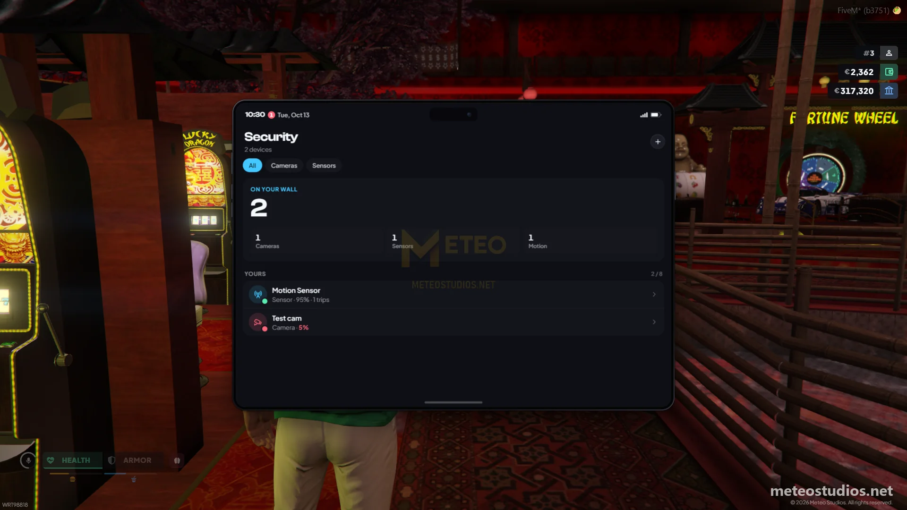
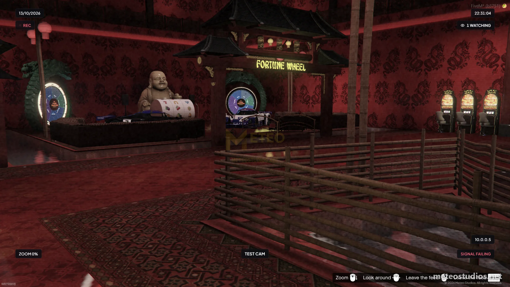
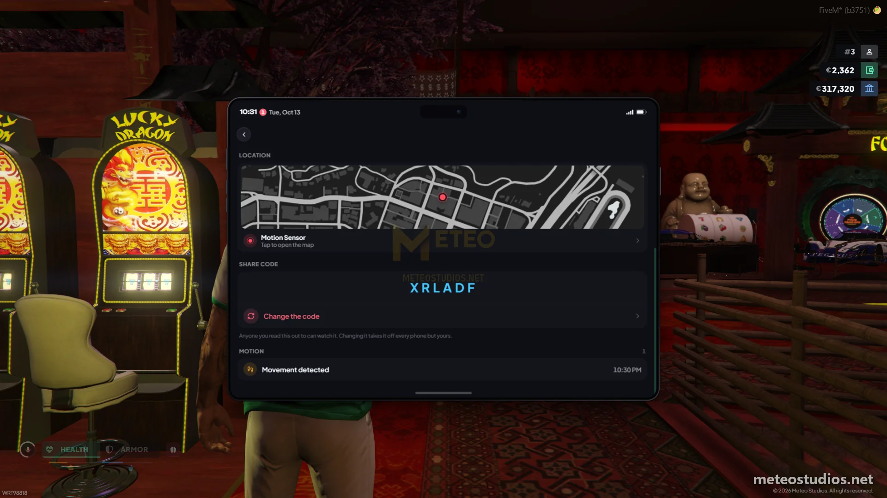

# Meteo Police Job

<figure><figcaption>
Security cameras
</figcaption></figure>

<figure><figcaption>
Security cameras
</figcaption></figure>

<figure><figcaption>
Security cameras
</figcaption></figure>

This is a guide about testing the Meteo V2 police job script designed exclusively for the Meteo V2 package. full police job with cuff break minigame, ankle cuffs, escort system, headbag, search and seize, megaphone, ballistic shield, deployable objects, 43 security cameras, grade-locked armory and an in game creator for stations and cameras.


Get access to our exclusive video testing guide on Discord to see all of this in action.



Try it yourself for free on our showcase server. [See here to get access](../../how-to/how-to-access-showcase-server.md).


***

## Before You Start

* Access to the meteo showcase server
* Know how to [spawn items](../../how-to/how-to-spawn-items.md)
* Police job: `/setjob yourid police 4` (grade 4 gives full access to all armory items and boss features)
* Familiar with [getting started](../../getting-started.md) basics

***

## Sandy Sheriff Station

| Location                | Teleport                            | Notes                           |
| ----------------------- | ----------------------------------- | ------------------------------- |
| Duty station            | `/tp 1826.77, 3670.90, 34.70`       | toggle on duty here first       |
| Armory                  | `/tp 1826.74, 3684.59, 34.85`       | buy police supplies and weapons |
| Personal locker (stash) | `/tp 1825.86, 3681.82, 34.60`       | store your items                |
| Security cameras        | `/tp 1819.95, 3665.79, 38.74`       | view 43 cameras around the map  |
| Trash                   | `/tp 1824.60, 3676.55, 34.64`       | shared station trash            |
| Locker room (clothing)  | `/tp 1830.97, 3674.07, 38.03`       | change into police uniform      |
| Boss menu               | `/tp 1820.04, 3663.10, 34.71`       | requires grade 4                |
| Police garage           | `/tp 1827.19, 3687.62, 34.17`       | get police vehicles             |
| Heli refuel             | `/tp 1811.19, 3675.34, 42.66`       | refuel helicopters, see [meteo-fuel](../meteo-fuel/) |


This is the station the package uses on the showcase server. Stations and cameras are built in game, so you can add, move or remove them for any map you use - see [Station and Camera Creator](#station-and-camera-creator) below.


***

## Testing Police Features



**Go on duty**

teleport to the duty station and toggle on duty first. open f1 menu and go to job options to see all police actions like cuff, escort, search and more



**Test cuffing**

get `handcuffs` from armory or spawn `/giveitem yourid handcuffs 1`. go near a player and use handcuffs on them. the player being cuffed will get a cuff break minigame - if they succeed they break free and you get knocked back. if they fail they get cuffed. to uncuff use `cuffkeys` - `/giveitem yourid cuffkeys 1`. the knock back animation can be turned off in the admin menu (Script Settings > Police) if your server does not want it



**Test ankle cuffs**

you can apply ankle cuffs to already cuffed players. ankle cuffs force them to walk very slowly and blocks vehicle entry completely. remove with cuff keys



**Test lockpick cuffs (criminal side)**

cuffed players can try to lockpick their cuffs with lockpick items:

* `lockpick` - hard difficulty
* `advancedlockpick` - medium difficulty

the better lockpick is used first. it plays a lockpick minigame from [meteo-minigames](../meteo-minigames/) and there is a chance the lockpick breaks on success or failure



**Test escort system**

you can escort cuffed players, dead players or regular players. escorted players are attached to you and move with you. you can put escorted players into vehicles and take them out. escorted players cant fight or use weapons



**Test headbag**

spawn `/giveitem yourid headbag 1` and use it on a player. it blinds them with a full screen overlay. if they try to sprint, jump or fight with headbag on they will ragdoll



**Test search and seize**

point target at a player and select search player to open their inventory. you can also seize their cash - it creates a moneybag item with the cash inside



**Test megaphone**

spawn `/giveitem yourid megaphone 1` and use it. it broadcasts your voice to 50 meters range with radio FX effects. press E to talk, X to put away



**Test police shield**

spawn `/giveitem yourid police_shield 1` and use it. your character holds the ballistic shield. you cant enter vehicles while shield is active, and the shield no longer shoves parked vehicles around when you walk into them. when you put it away it shows on your back (needs [meteo-weaponback](../meteo-weaponback/))



**Test deployable objects**

you can place these items from armory on the ground:

* `police_cone` - traffic cone
* `police_barrier` - work barrier
* `police_roadsign` - road sign
* `police_tent` - crime scene tent
* `police_light` - work light
* `police_chair` - chair
* `police_table` - table
* `police_spike` - tire spikes (max 5 per officer)

go near the placed object and pickup to remove it



**Test security cameras**

go to the security cameras terminal at the station. you can view 43 cameras around the map (LTD gas stations, 24/7 stores, banks and liquor stores). use controls to rotate the camera and switch between cameras



### Station and Camera Creator



**Open the creator**

open the admin menu with `/admin` and go to Script Settings > Police. the Creator section lists every police station and security camera



**Build a station**

pick Police station, name it and aim at the front of the station for the map blip. then add its duty spots, armory points, lockers, evidence bins and camera desks wherever you want them



**Add a camera**

pick Security camera, aim where the camera hangs and click, then look through it and click again to save the view. you can choose if officers can turn it and if it shows as online or lost signal



**Tune the rest**

in the same menu you can change which jobs count as police, how hard breaking out of cuffs is, the cuff break animation, lockpicks, armory items and ranks, and what the deployable items place



***

## Also Make Sure to Check

these are all connected with police job and have their own testing guides:


[meteo-mdt](../meteo-mdt/)



[meteo-evidence](../meteo-evidence/)



[meteo-policeradar](../meteo-policeradar/)



[meteo-jobgarage](../meteo-jobgarage/)



[meteo-jail](../meteo-jail/)


***

## Good to Know


Who counts as police, cuff break difficulty and animation, lockpicks, armory items and ranks, deployable objects and the spike limit are all editable in-game from **Script Settings** in the admin menu ([meteo-manage](../meteo-manage/)) - no code editing needed, and your changes survive script updates. Add or edit police stations (duty spots, armory points, lockers, evidence bins, camera desks) and security cameras in-game with the Police creator. Script Settings is god-tier only.


* armory items are grade locked - higher grades unlock better weapons and equipment
* dispatch is now part of [meteo-mdt](../meteo-mdt/), so 911 calls and alerts are handled from the MDT
